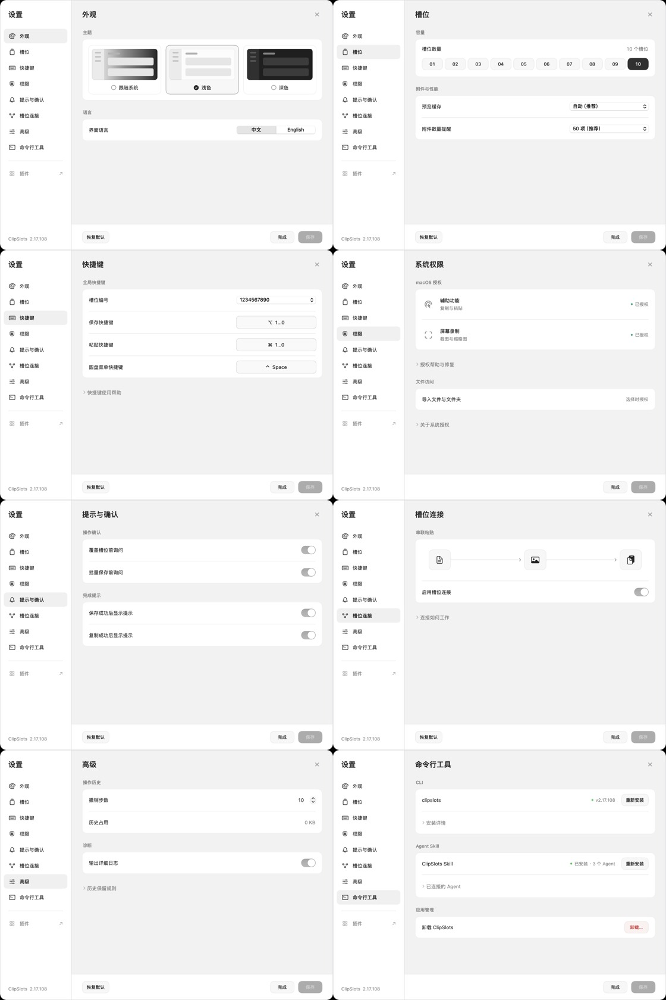
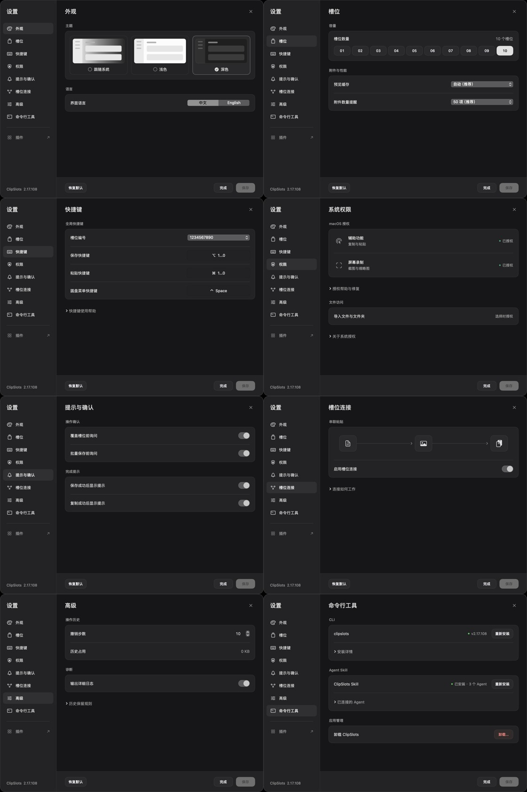

# 打包、导入与设置升级

Build 21710839 已完成打包、导入和设置升级，并替换本机 `/Applications/ClipSlots.app`。298 项专项验收及 43,884 项基础库检查通过。正式 App 的系统权限续授权与部分交互复测尚待本人完成 macOS 身份验证，详情见文末。

## 已确认的缺陷与修复

| 触发条件 | 原行为 | 修复 |
| --- | --- | --- |
| 多选标准槽位包 | 仅处理第一个匹配扩展名的包 | 每个文件按内容分类，槽位包顺序导入 |
| 多选改名包或混选附件 | 改名包进入普通附件分支，或其他选择被丢弃 | 统一分类保留普通文件，损坏包单独报告 |
| Finder 打开多个文件 | 仅实现 `openFiles` 时未导入；仅补 `onOpenURL` 后仍遗漏第二个文件 | 首个 URL 由 `onOpenURL` 接收，其余由 `application(_:open:)` 接收，全部进入同一串行队列；启动时暂存尚未就绪的请求 |
| 文件名含 `*` 等通配字符 | 系统 zipinfo 可能同时匹配相邻归档 | 使用系统 libarchive，以字面路径读取 |
| 零字节附件 | 被认为没有可导出的内容而丢弃 | 保留空文件字节及原始名称 |
| 附件名接近文件系统长度上限 | 添加内部 UUID 前缀后可能无法创建文件 | 限制内部文件名 UTF-8 长度，显示名称完整保留 |
| slot.json 损坏、附件缺失、槽位超出配置 | 静默跳过或留下空壳，仍提示成功 | 写库前完整校验；读写失败触发事务回滚 |
| 版本、数量、重复标识或编号不一致 | 缺少一致性检查 | 拒绝不支持或不一致的清单 |
| 导出替换目标失败 | 先移除旧目标，再移动新包 | 在目标同目录生成临时包，通过原子 rename 提交 |
| 新建导入组 | 图标与颜色未恢复 | 内容写入成功后在存储锁内统一提交外观元信息 |
| 历史导入备份对应的正式组非空 | 将非空误判为完整，删除备份 | 保留不确定的两份数据，报告需恢复 |

Finder 槽位包类型及打开事件已接入同一导入入口。最终候选实际执行冷启动与运行中两次双文件打开，四个改名包均完整导入且各出现一次。最初两次失败保留在 `file-open-first-runs.json`，最终数据见 `file-open-regression.json`。

## 设置页面升级

八页共用原生 SwiftUI 组件：外观、槽位、快捷键、系统权限、提示与确认、槽位连接、高级、命令行工具。

- 统一 20 pt 页面标题、13 pt 控件文字、12 pt 分组与状态文字，58 pt 基础行高、12 pt 分组圆角。
- 主题使用可直接选择的缩略预览；中英文使用双选分段；槽位数量直接选择 01–10。
- 低频说明和安装详情默认折叠。权限采用同一行内的状态与操作，通知开关采用一致的正向语义。
- 底部始终保留操作区，无变更时显示“完成”，有变更时显示“取消”并启用“保存”。
- 设置为草稿；取消、关闭与外部关闭都会撤回主题和语言预览。“恢复默认”只作用于当前页，保存之前不覆盖持久化配置。
- 快捷键以系统按键控件录入；Esc 取消，Tab 离开，录入完成后退出捕获。空格、方向键与 F1–F12 不再被误转为槽位占位符。
- 历史磁盘占用转至后台计算；读取 CLI 版本优先使用应用元数据，避免仅打开设置便初始化正式数据目录。
- 卸载对话框默认保留槽位数据。

**166 项通过，0 项失败**。覆盖 8 页 × 中文/English × 浅色/深色 × 720/880 pt，共 64 个布局状态，以及保存、取消、关闭、预览回滚、恢复默认、帮助折叠、快捷键状态和实际控件高度。首次 10 项失败涉及字段高度与焦点/默认值测试，修复后重跑通过；首轮结果单独保留。32 张完整页面截图见 `settings/`。

## 核心回归

执行环境：Apple Silicon / arm64，macOS 26.6.2（25G83），Apple Swift 6.1.2；应用最低部署目标 macOS 13。

真实 `PackExporter`、`PackImporter`、`PackArchive` 与 release `ClipSlotsKit` 参与测试。仅两个 GUI 缓存失效方法使用空实现，未替换存储、打包或导入逻辑。所有数据均为隔离生成的最小样本。

**108 / 108 通过**：`en_US.UTF-8` 与 `C` 两种进程语言环境，各 54 项。

- 完整正文、标签、附件字节、空文件、仅标签槽位的导出与往返。
- 13 类改名：标准后缀、大小写、中文空格、无后缀、ZIP 后缀、方括号、星号、问号、前导连字符、emoji、百分号、多个点、换行。
- 相对路径与移动至嵌套目录；多选包、改名包和普通文件/目录混合分类。
- 含 `manifest.json` 的普通 ZIP 保持为普通附件，不误判为槽位包。
- 空选择、覆盖已有包、失败目标保留、长 Unicode 附件名、进度计数。
- 旧格式目录扫描、缺失可选 page.json、缺失缩略图字段、ZIP64。
- 损坏 JSON、丢失附件/缩略图、不支持版本、统计错误、重复标识、编号不一致。
- 路径穿越、绝对路径、换行条目、大小写碰撞、文件/目录碰撞、超大元数据、符号链接、截断归档、CRC 错误。
- 不同槽位配置、跳过页面、跳过组、图标颜色恢复。
- 覆盖首组后因组数上限失败：原正文、原标签、独立附件目录恢复一致。
- 中断导入留下旧备份：保留备份并拒绝继续覆盖。
- 展开容量及条目数量保护。

旧版独立基线也实际执行过。基线包含零字节文件完整性断言，因此其中“改名往返失败”不能全部解释为文件名识别失败；旧版单文件改名并非普遍失败，核心分流问题是多选路径。

## 复现

构建共享库后，用仓库 `scripts/disk_guard.py run` 包裹 `scripts/test-pack-transfer.py --output <隔离输出目录>`，将 `.build`、输出目录和本任务全部现有输出登记在同一 4 GiB 预算内。脚本不启动正式 CLI，不读取正式槽位数据。

测试入口：`Tests/PackTransferRegression/main.swift`。归档变体：`Tests/PackTransferRegression/fixtures.py`。头文件桥接：`Sources/CArchive`，链接 macOS 自带 libarchive，不额外捆绑二进制依赖。

设置测试入口：`Tests/SettingsRegression/Fixture.swift` 与 `scripts/test-settings.py`。脚本使用实际 GUI 源码，替换测试入口后整模块编译；传入已有测试 App 的 `--bundle` 和隔离目录 `--output`。所有 UI 状态均运行真实 SwiftUI/AppKit 控件。整模块编译是必要条件，不能仅替换 Release 的 `main.swift.o`，否则会丢失跨文件泛型特化符号。

文件打开回归入口：`scripts/test-pack-open.py --bundle <独立候选App> --fixture <单页回归包> --output <不存在的测试目录>`。同样须通过磁盘保护器执行。脚本强制检查独立 bundle ID 与 `ClipSlotsIsolatedCandidate=true`，将数据与配置指向测试目录，通过 macOS `open` 发送真实文件事件，并核验页面唯一性、正文、标签、外观及附件字节。冷启动前需退出候选 App。

## 最终候选 GUI 与发布包

| 检查 | 结果 |
| --- | --- |
| 原生文件面板同时选择标准包、`.bin` 改名包、无后缀包 | 三个文件全部处理，冲突追加后四个页面内容完整 |
| 原生打包面板仅勾选两个组，再通过保存面板导出 | 清单准确记录两页、两组、四槽位；空附件与 ZIP CRC 通过 |
| macOS 冷启动、运行中批量打开 | 两种状态各两个改名包全部导入，未丢失、未重复 |
| 最终窗口浅色、深色、English 预览与取消 | 主题/语言即时变化，取消恢复中文及浅色 |
| 候选与隔离窗口等价性 | 可执行内容和所有界面资源相同，仅签名、Dock 图标与外部 Skill 安装资源存在记录的差异 |
| 压缩包 | 32,257,036 字节，30.76 MiB，小于 31 MiB；逐文件与签名候选核验一致 |
| 基础库 | 43,884 项通过，0 失败 |
| 专项验收汇总 | 298 项通过：打包导入 108、设置 166、打包后的 CLI/MCP 14、最终窗口 10 |

基础库检查和专项检查采用不同粒度，分开报告；不把同一批数据的重复读取再次计数。所有 GUI 导入均使用隔离样本，未向正式槽位库写入测试内容。

## 缺陷定位与验收方法

1. 用最小数据样本导出正文、标签、普通附件和零字节附件；将输出复制为 13 类不同文件名，分别校验清单、导入结果与实际字节。
2. 对旧版进行独立基线验证，再检查工具栏多选路径，区分“包本身可读”与“UI 是否把所选文件交给包导入器”。文件名识别不再依赖外部 `zipinfo` 的匹配规则。
3. 构造损坏、缺失和冲突归档，记录导入前组标识、正文、标签及附件目录，确认拒绝或回滚之后没有部分写入。
4. 用真实设置窗口覆盖 64 种布局状态，检查导航与底部按钮可见性；对快捷键控件增加实际尺寸和焦点退出检查。首次失败结果单独保留，最终结果以修复后重跑为准。
5. 通过原生文件选择器执行改名包多选；导入后读回独立存储中的正文、标签、组外观和附件字节，再验证 Finder 打开事件。
6. 发布门禁将源码哈希、Release 二进制、候选窗口可执行内容、压缩包文件清单和安装后应用串联校验。源码变更后旧证据不能直接复用。

单项通过的判据是实际结果断言成立；仅点击了按钮、命令返回成功或出现“导入完成”提示均不足以证明内容完整。

## 验证边界

当前结果来自本机 Apple Silicon macOS。尚未实测 Intel Mac、其他 macOS 版本、网络卷、真实磁盘耗尽、断电或多进程同时写入；也未把有限测试解释为“任意环境都保证成功”。当前保护上限为 100,000 个归档条目、8 GiB 展开容量、10 MiB JSON/标准缩略图元数据。改名后文件的系统默认关联可能随扩展名改变；从应用内导入或在 Finder 选择用 ClipSlots 打开时，按内容识别。

本次没有重新测量严格持续 60fps，不将此前性能未达标项计作已修复。

## 交付记录

- 已安装 Build 21710839，签名核验通过。8,631 个原始数据与配置文件核验一致；剔除 93 个运行时锁文件后，8,538 个文件复核通过。画布节点坐标单独比较，未作坐标归一化或改写。
- 复用已验证的完整备份，新增数据对象仅 3,414 字节；备份总量 30.11548 GiB，低于已授权的 31 GiB。旧版应用恢复重建验证通过。
- 正式窗口已验证六品牌卡片显示、详情往返、侧栏关闭重开，以及全局搜索匹配、空结果和清除恢复。结果见 `installed-interaction.json`。
- 新签名后，macOS 将辅助功能、屏幕录制标为未授权；“隐私与安全性”已显示触控 ID / 密码验证窗口，须由用户本人操作。六品牌真实鼠标悬停回弹、滚轮滚动和程序坞外部粘贴尚未验收；一次 Claude 悬停尝试没有观察到像素变化，未据此判断程序缺陷或宣称通过。
- GitHub 以 `v2.17.108-build21710839` 独立预发布标签提供压缩包及 SHA-256，保留原有正式发布。身份验证完成后可继续剩余的本机权限与交互复测。
